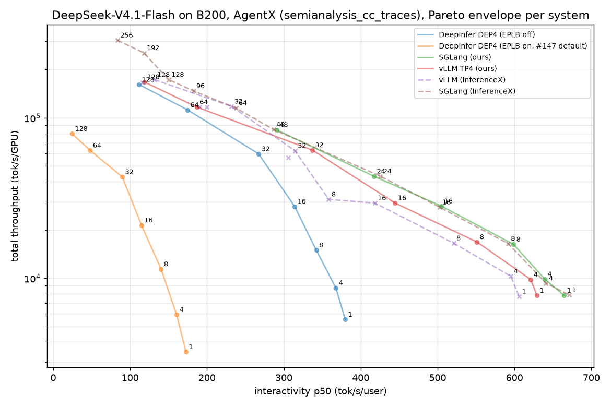

# AgentX on 8×B200 (4 GPUs per server): DeepInfer vs SGLang vs vLLM — snapshot 2026-10-22 11:30 UTC

DeepSeek-V4.1-Flash-1017, `semianalysis_cc_traces_weka_062126`, agentx-harness 1.0.12, 3600 s per point, fresh server per concurrency, synthetic acceptance length 3.51 (InferenceX golden AL, DSpark/MTP 5, thinking on). Metrics computed with InferenceX's own code (`bench/agentx_metrics.py`). Full table: [agentx_table.md](agentx_table.md); regenerate with `bench/agentx_report.py`.

**Findings**
1. **The method reproduces InferenceX.** Our vLLM TP4 run matches the published points at all 7 concurrencies (throughput 0.95–1.02×), and our SGLang run matches at the 6 finished concurrencies (0.99–1.06×).
2. **DeepInfer with the #147 server defaults is 2–5× behind** because EPLB rearrangement is hard-wired on; it stalls all ranks for 28–51% of wall time. Reported upstream: deepseek-ai/DeepInfer#147 (comment 6334191794).
3. **DeepInfer DEP4 with EPLB off:** throughput/GPU at c ≥ 16 is within 3–5% of vLLM TP4. Interactivity is 0.63–0.66× at c ≤ 8 (DP attention puts one request on one GPU; TP4 spreads it over four) and 0.92–0.96× at c ≥ 64. TTFT p50 is 3–4× vLLM's at every concurrency.
4. **SGLang leads at high concurrency** (DEP4 + HiCache, c=96–256 published; our c ≥ 64 still running).

**Caveats**
- DeepInfer runs a patched tree: OpenAI server #147, host prefix cache #144, synthetic acceptance, sticky-balanced routing, EPLB flags (`patches/`).
- DeepInfer uses YoCo compact prefill truncation (keep=140, server default). It **changes greedy outputs** (3/32 identical vs keep=0, while keep=0 is deterministic and batch-invariant; #16). A YoCo-off A/B at c=64 is running.
- The vLLM DEP2 rows (InferenceX) use 2 GPUs; per-GPU numbers are still comparable.

中文

# 8×B200 上的 AgentX（每个 server 4 卡）：DeepInfer vs SGLang vs vLLM，2026-10-22 11:30 UTC 快照

**结论**
1. **我们的测试方法能复现 InferenceX 的公开结果。** vLLM TP4 的 7 个并发点全部对上（吞吐 0.95–1.02×）；SGLang 已跑完的 6 个点也对上了（0.99–1.06×）。
2. **按 #147 server 的默认配置，DeepInfer 落后 2–5 倍**，原因是 server 里写死开启了 EPLB 重排，它让所有 rank 停顿，占墙钟时间的 28–51%。已反馈到上游 PR #147。
3. **关掉 EPLB 后的 DeepInfer DEP4：** c≥16 时每卡吞吐与 vLLM TP4 只差 3–5%。interactivity 在 c≤8 时只有 0.63–0.66×（DP attention 下一个请求只用一张卡，TP4 能用四张），c≥64 时为 0.92–0.96×。TTFT p50 在所有并发下都是 vLLM 的 3–4 倍。
4. **高并发下 SGLang 领先**（DEP4 + HiCache；公开数据覆盖 c=96–256，我们自己的 c≥64 还在跑）。

**注意事项**
- DeepInfer 跑的是打了补丁的代码：OpenAI server（#147）、主机前缀缓存（#144）、合成接受率、sticky-balanced 路由，以及 EPLB 开关（补丁都在 `patches/` 下）。
- DeepInfer 用了 YoCo compact 截断（keep=140，server 默认值），它**会改变 greedy 输出**：与 keep=0 相比只有 3/32 一致，而 keep=0 本身是确定的、也不受 batch 组成影响（见 #16）。c=64 关闭 YoCo 的 A/B 正在跑。
- InferenceX 公开的 vLLM DEP2 结果用的是 2 卡，按每卡算的数字仍然可以直接比较。

