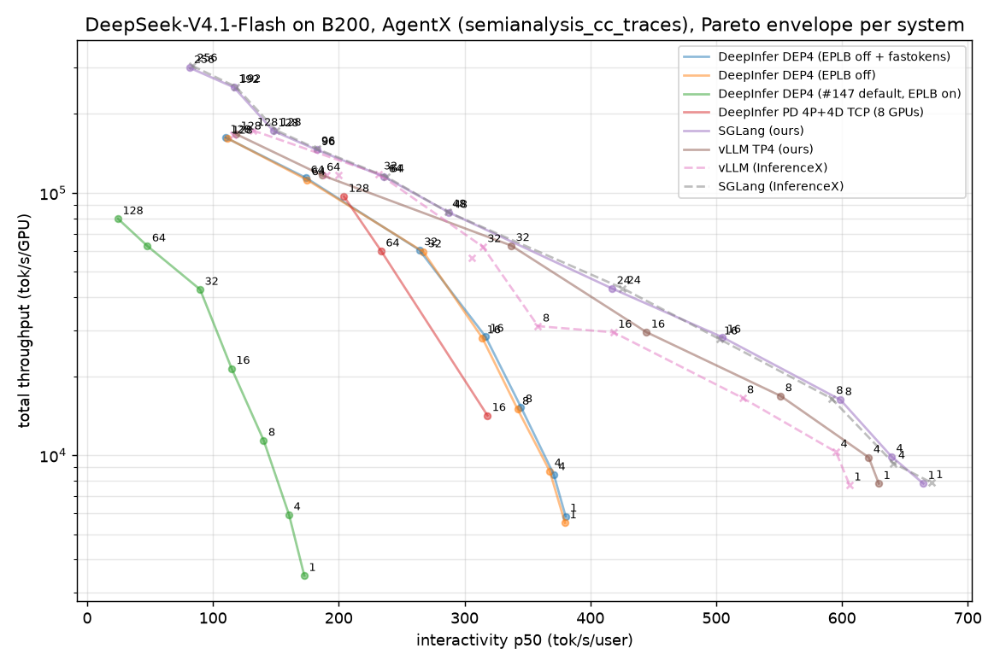
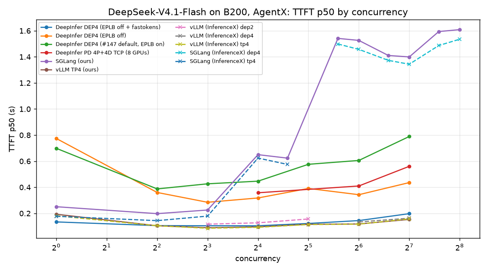

# AgentX on 8×B200: DeepInfer vs SGLang vs vLLM — snapshot 2026-10-23 07:30 UTC

DeepSeek-V4.1-Flash-1017, `semianalysis_cc_traces_weka_062126`, agentx-harness 1.0.12, 3600 s per point, fresh server per concurrency, synthetic acceptance length 3.51 (InferenceX golden AL). Servers use 4 GPUs; the PD row uses 8. Metrics come from InferenceX's own code (`bench/agentx_metrics.py`). Full table: [agentx_table.md](agentx_table.md). Regenerate with `bench/agentx_report.py`. Supersedes `results/20261022_agentx/`.

**DeepInfer headline** (`deepinfer-ix-ep4-noeplb-fastok`: #147 server + EPLB off + fastokens prompt tokenization). Ratios vs vLLM TP4 (InferenceX published):

| c | 1 | 4 | 8 | 16 | 32 | 64 | 128 |
|---|---|---|---|---|---|---|---|
| throughput / GPU | 0.76 | 0.82 | 0.92 | 0.97 | 0.97 | 0.98 | 0.98 |
| interactivity p50 | 0.63 | 0.62 | 0.66 | 0.76 | 0.84 | 0.92 | 0.95 |
| TTFT p50 s (DeepInfer / vLLM) | 0.13 / 0.18 | 0.11 / 0.10 | 0.11 / 0.09 | 0.10 / 0.09 | 0.12 / 0.11 | 0.14 / 0.12 | 0.20 / 0.16 |

**Findings**
1. **The reproduction is faithful.** Our vLLM TP4 runs match all 7 published points (throughput 0.95–1.02×). Our SGLang runs match all 12 published points (0.98–1.06×), including the DEP4 + HiCache points with two servers sharing the host.
2. **DeepInfer out of the box (#147 defaults) is 2–5× behind** because EPLB rearrangement is hard-wired on and stalls all ranks for 28–51% of wall time (#5). It is reported upstream on #147.
3. **The TTFT gap was the frontend tokenizer.** HF `tokenizers` takes ~240 ms per 167K-token prompt; `fastokens`, which vLLM's Rust frontend uses, takes 2 ms with identical ids (#17). With it, DeepInfer TTFT p50 is within 10–40 ms of vLLM, and lower at c=1. This is suggested upstream on #147.
4. **What remains is structural.**
   - Low-concurrency interactivity is 0.62–0.76× at c ≤ 16: DP attention gives one request one GPU, while TP4 gives it four.
   - The long-prefill tail: cold 300K-token prompts are ~23× slower than vLLM, more than the 4× GPU count explains. Not yet profiled.
5. **SGLang:** best throughput at high concurrency (DEP4 + HiCache up to c=256, 305K tok/s/GPU). Its TTFT is 1.3–1.6 s on DEP4 points, both in our runs and in InferenceX's. Hypothesis, untested: the default `--tokenizer-backend huggingface`; SGLang also supports `fastokens`.
6. **PD 4P+4D (TCP, upstream #197)** on 8 GPUs gives the best per-user speed at c ≥ 64 (interactivity 1.2–1.75× vLLM TP4) at about half the throughput per GPU. Mooncake nvlink_intra transport runs are in progress (#18, draft upstream PR deepseek-ai/DeepInfer#214).

**Caveats**
- DeepInfer runs a patched tree: #144 prefix cache, #147 server, synthetic acceptance, sticky-balanced routing, EPLB flags, fastokens (`patches/`).
- YoCo compact truncation (keep=140, required by the #144 prefix cache) changes greedy outputs versus keep=0. keep=0 itself is deterministic and batch-invariant. Quality impact is not evaluated (#16).
- InferenceX's vLLM DEP2 rows use 2 GPUs; per-GPU numbers are still comparable.

中文

# 8×B200 上的 AgentX：DeepInfer vs SGLang vs vLLM，2026-10-23 07:30 UTC 快照

模型 DeepSeek-V4.1-Flash-1017，数据集 `semianalysis_cc_traces_weka_062126`，agentx-harness 1.0.12，每个点 3600 s，每个并发都重新起 server，合成接受长度 3.51（InferenceX 的 golden AL）。server 用 4 张卡；PD 那一行用 8 张卡。指标用 InferenceX 自己的代码计算。本快照取代 `results/20261022_agentx/`。

**DeepInfer 主结果**（`deepinfer-ix-ep4-noeplb-fastok`：#147 server + 关闭 EPLB + fastokens 编码 prompt），数字见上表，都是相对 InferenceX 公开的 vLLM TP4 的比值。

**结论**
1. **复现方法可靠。** 我们跑的 vLLM TP4 与官方 7 个点全部对上（吞吐 0.95–1.02×）；SGLang 与官方 12 个点全部对上（0.98–1.06×），其中包括两个 server 共用一台机器跑的 DEP4 + HiCache 点。
2. **DeepInfer 开箱即用（#147 默认配置）落后 2–5 倍。** 原因是 server 里写死开启了 EPLB 重排，它让所有 rank 停顿，占墙钟时间 28–51%（#5）。已在 #147 反馈给上游。
3. **TTFT 的差距来自前端 tokenizer。** HF `tokenizers` 编码一个 16.7 万 token 的 prompt 要约 240 ms；vLLM Rust 前端用的 `fastokens` 只要 2 ms，结果完全相同（#17）。换上之后，DeepInfer 的 TTFT p50 和 vLLM 只差 10–40 ms，c=1 时还更快。已在 #147 向上游提出建议。
4. **剩下的差距来自结构。**
   - c ≤ 16 时 interactivity 只有 0.62–0.76×：DP attention 下一个请求只用一张卡，TP4 能用四张。
   - 长 prefill 的长尾：30 万 token 的冷 prompt 比 vLLM 慢约 23 倍，超出 4 倍卡数差能解释的范围，还没有 profile。
5. **SGLang：** 高并发下吞吐最好（DEP4 + HiCache 一直到 c=256，每卡 30.5 万 tok/s）。但它在 DEP4 各点上的 TTFT 有 1.3–1.6 s，我们的结果和 InferenceX 都是如此。推测（未验证）原因是默认的 `--tokenizer-backend huggingface`；SGLang 也支持 `fastokens`。
6. **PD 4P+4D（TCP，上游 #197）** 用 8 张卡，在 c ≥ 64 时每用户速度最快（interactivity 是 vLLM TP4 的 1.2–1.75×），代价是每卡吞吐只有约一半。Mooncake nvlink_intra 传输的测试正在跑（#18，上游 Draft PR deepseek-ai/DeepInfer#214）。

**注意事项**
- DeepInfer 跑的是打了补丁的代码：#144 前缀缓存、#147 server、合成接受率、sticky-balanced 路由、EPLB 开关、fastokens（补丁都在 `patches/`）。
- YoCo compact 截断（keep=140，#144 前缀缓存的前提）与 keep=0 相比会改变 greedy 输出。keep=0 本身是确定的，也不受 batch 组成影响。对质量的影响还没有评估（#16）。
- InferenceX 公开的 vLLM DEP2 结果用 2 张卡，按每卡算的数字仍然可以直接比较。

