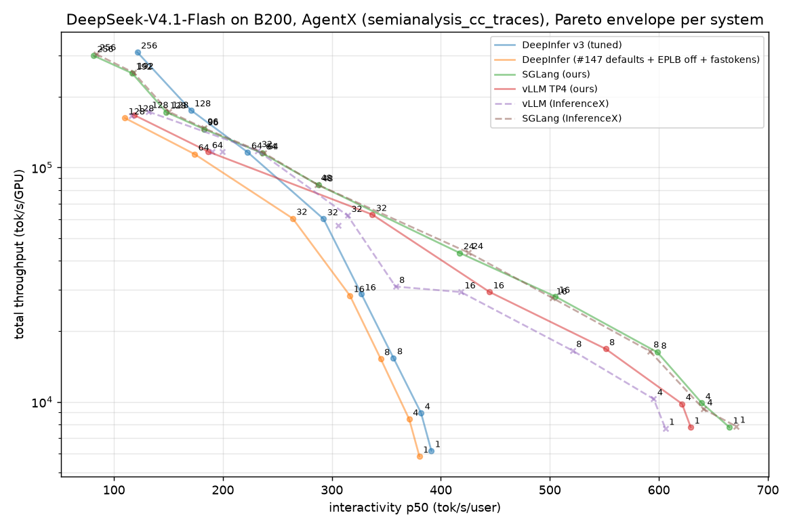
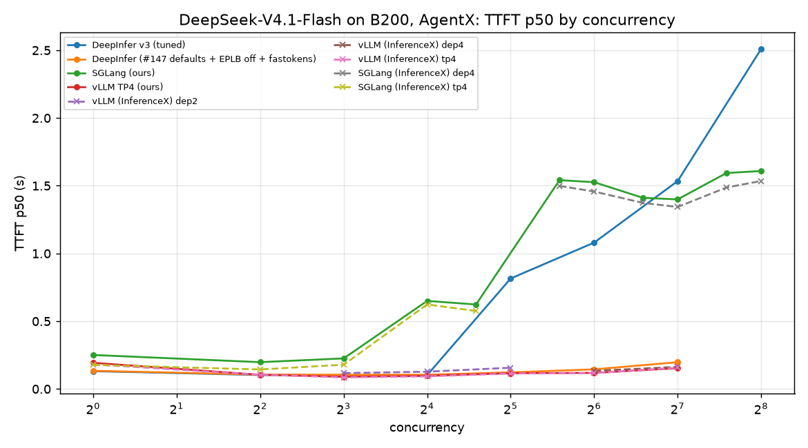

# AgentX on 8×B200: tuned DeepInfer (v3) vs SGLang vs vLLM, 2026-10-24

Setup: DeepSeek-V4.1-Flash-1017, `semianalysis_cc_traces_weka_062126`, agentx-harness 1.0.12, 3600 s per point, a fresh server per concurrency, synthetic acceptance length 3.51 (InferenceX golden AL). Each server uses 4 GPUs. Metrics come from InferenceX's own code. Full table: [agentx_table.md](agentx_table.md). Goal and history: #21. Supersedes `results/20261023_agentx/`.

**DeepInfer v3** (`deepinfer-ix-ep4-v3`) is the #147 server on `deepinfer:agentx-v2` plus:
- `DEEPINFER_OVERRIDE_NUM_EXTRA_EXPERTS=0`. The server's 32 redundant experts only serve EPLB, which is off.
- `--prefill-any-interval` per concurrency: 2 at c ≤ 16, 100 at c ≥ 32. #147 uses 2; the engine default is 100.
- A persistent JIT cache, and host prefix-cache pools pinned before the server reports ready.

Ratios are against the stronger of SGLang (ours) and vLLM / SGLang (InferenceX) at each point:

| c | tok/s/GPU | / best | intvty p50 | / best | TTFT p50 |
|---|---|---|---|---|---|
| 1 | 6,186 | 0.79 | 391 | 0.59 | 0.13 s |
| 4 | 8,967 | 0.87 | 382 | 0.60 | 0.10 s |
| 8 | 15,399 | 0.91 | 356 | 0.59 | 0.10 s |
| 16 | 28,864 | 0.98 | 327 | 0.65 | 0.10 s |
| 32 | 60,355 | 0.97 | 292 | 0.93 | 0.82 s |
| 64 | 116,178 | 0.99 | 223 | 0.94 | 1.08 s |
| 128 | **175,862** | **1.02** | **171** | **1.15** | 1.53 s |
| 256 | **310,586** | **1.02** | **121** | **1.45** | 2.51 s |

**Findings**
1. **At c ≥ 128 DeepInfer beats both SGLang and vLLM** on throughput and interactivity. At c=32–64 it is within 1–3% on throughput and 0.93–0.94× on interactivity.
2. **The largest lever was the prefill vote interval.**
   - In DeepInfer's NORMAL engine a prompt step is collective, and no rank decodes in it.
   - With `--prefill-any-interval 2`, almost every arriving request pauses all four ranks' decode.
   - With 100, at c=256 interactivity p50 rises from 55 to 119 (900 s pair) and throughput by 21%.
   - The price is TTFT: 2.5 s at c=256 vs SGLang's 1.5 s. At c ≤ 16 the interval doesn't help, so it stays at 2 there.
   - An optional QUORUM vote (`deepinfer:agentx-v3`, `--prefill-quorum`) gives other TTFT ↔ interactivity points, e.g. c=256 at 1.06 s TTFT. It is off by default.
3. **The low-concurrency gap is structural.** vLLM / SGLang serve c ≤ 24 with TP4, about 5.6 ms per decode step. DeepInfer has only EP MoE: the fused MoE kernel takes 13 ms per step even at one request per rank, for the per-layer all-to-all. CP keeps EP MoE, and EP2 doesn't fit (162.5 GiB of weights per GPU). Closing this needs TP MoE in DeepInfer.
4. **The earlier "cold long prompt 23× slower" was setup, not prefill.** Fresh containers recompiled every TileLang kernel, and the host pools were pinned lazily on each rank's first request. Warm, prefill is 64–66K tok/s vs vLLM TP4's 86–89K (0.74×).
5. **Mooncake.**
   - With the Store as L3 over EFA (Mooncake main), least-loaded routing matches sticky routing on AgentX: 7 ms per L3 hit, 0 failures.
   - A restarted server gets its prefix back from L3: TTFT 172 ms vs 1,574 ms.
   - See #20.

**Caveats**
- DeepInfer runs a patched tree: #144 prefix cache, #147 server, synthetic acceptance, sticky-balanced routing, the eager-pinning fix (`patches/deepinfer-agentx-v2-pr144-pr147upstream.patch`).
- The c=32 point comes from a separate run with interval 100 (`deepinfer-ix-ep4-v3-c32pai100`); the series run used 30 (281 interactivity, 0.33 s TTFT).
- **The c=128 / c=256 points reproduce.** A repeat 3600 s run gave c=128 176,217 tok/s/GPU / 170.9 interactivity (vs 175,862 / 170.6), and c=256 310,601 / 122.6 (vs 310,586 / 121.4). The run-to-run spread is within 0.2–1%, below the 2% lead.

中文

# 8×B200 上的 AgentX：调优后的 DeepInfer（v3）对比 SGLang 和 vLLM，2026-10-24

测试环境：DeepSeek-V4.1-Flash-1017，数据集 `semianalysis_cc_traces_weka_062126`，agentx-harness 1.0.12，每点 3600 s，每个并发都重新起 server，合成接受长度 3.51（InferenceX 的 golden AL）。每个 server 用 4 张卡，指标用 InferenceX 自己的代码计算。

**DeepInfer v3** 是 #147 的 server（`deepinfer:agentx-v2`）加上以下改动：
- `DEEPINFER_OVERRIDE_NUM_EXTRA_EXPERTS=0`：server 默认的 32 个冗余专家只服务于 EPLB，而 EPLB 是关闭的。
- `--prefill-any-interval` 按并发设置：c ≤ 16 用 2，c ≥ 32 用 100。#147 设的是 2，引擎默认是 100。
- 持久化 JIT 缓存；server 报告 ready 之前就 pin 好主机前缀缓存池。

**结论**
1. **c ≥ 128 时，DeepInfer 的吞吐和 interactivity 都超过了 SGLang 和 vLLM。** c=32–64 时吞吐只差 1–3%，interactivity 是 0.93–0.94 倍。
2. **最大的杠杆是 prefill 投票间隔。**
   - DeepInfer NORMAL 引擎的 prompt step 是全组一起做的，这一步里所有 rank 都不 decode。
   - 间隔为 2 时，几乎每来一个请求，4 个 rank 的 decode 都要被打断一次。
   - 改成 100 后，c=256 的 interactivity p50 从 55 提升到 119（900 s 配对测试），吞吐 +21%。
   - 代价是 TTFT：c=256 时 2.5 s，SGLang 是 1.5 s。c ≤ 16 时间隔没有帮助，所以保持 2。
   - 可选的 QUORUM 投票（`deepinfer:agentx-v3`，`--prefill-quorum`）提供了其他 TTFT 与 interactivity 的取舍点，比如 c=256 时 TTFT 可以降到 1.06 s。默认关闭。
3. **低并发的差距是结构性的。** vLLM / SGLang 在 c ≤ 24 时用 TP4，每个 decode 步约 5.6 ms。DeepInfer 的 MoE 只有 EP 方式：即使每 rank 只有 1 个请求，融合 MoE kernel 每步也要 13 ms，花在每层的 all-to-all 上。CP 下的 MoE 仍然是 EP，EP2 又装不下（每张卡光权重就要 162.5 GiB）。要补上这块，需要 DeepInfer 支持 TP 方式的 MoE。
4. **之前"冷启动长 prompt 慢 23 倍"是测试环境的问题，不是 prefill 本身慢。** 每次新起容器都要重新编译所有 TileLang kernel，主机缓存池又是在每个 rank 第一个请求时才懒分配。充分预热后，prefill 是 64–66K tok/s，vLLM TP4 是 86–89K（0.74 倍）。
5. **Mooncake：**
   - Store 作为 L3 走 EFA（Mooncake main）时，AgentX 上 least-loaded 路由与 sticky 路由持平：每次 L3 命中 7 ms，零失败。
   - 重启后的 server 能从 L3 拿回前缀：TTFT 172 ms 对 1,574 ms。
   - 详见 #20。

**注意事项**
- DeepInfer 跑的是打了补丁的代码：#144 前缀缓存、#147 server、合成接受率、sticky-balanced 路由、提前 pin 内存的修复。
- c=32 这个点来自另一次单独的运行，用的是间隔 100（`deepinfer-ix-ep4-v3-c32pai100`）；序列里那次用的是 30（interactivity 281，TTFT 0.33 s）。
- **c=128 / c=256 的结果可以复现：** 重新跑了一次 3600 s，c=128 是 176,217 tok/s/GPU / interactivity 170.9（第一次是 175,862 / 170.6），c=256 是 310,601 / 122.6（第一次是 310,586 / 121.4）。两次运行之间的差异在 0.2–1% 以内，比 2% 的领先幅度小。

